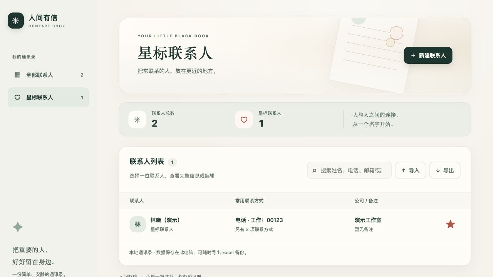
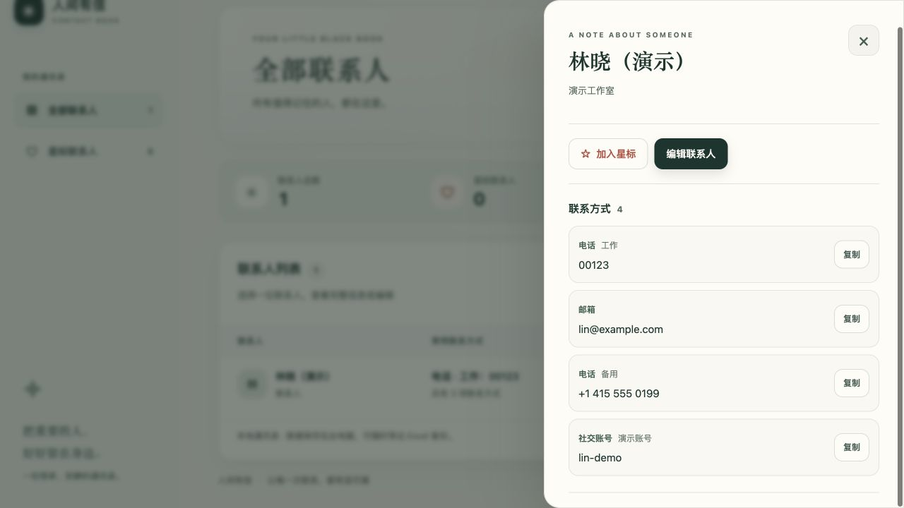

# 极限编程｜人间有信通讯录：把展示页的动效用到通讯录

| 项目 | 内容 |
| --- | --- |
| 课程 | [Software Engineering（FZU–MU）](https://bbs.csdn.net/forums/2601_MU_SE_FZU) |
| 队名 | 人间有信 |
| 作业要求 | [Extreme Programming](https://bbs.csdn.net/topics/620593436) |
| 作业目标 | 完成星标、多联系方式、Excel 导入导出，记录协作与验收过程。 |
| 参考资料 | [Python 标准库](https://docs.python.org/3/library/)、[GitHub Pull Request 文档](https://docs.github.com/en/pull-requests) |

作者：`jasonxie2026-fzu`

## 目录

1. [项目链接](#项目链接)
2. [我的开发记录](#我的开发记录)
3. [功能实现](#功能实现)
4. [运行截图和视频](#运行截图和视频)
5. [提交与分工](#提交与分工)
6. [联调遇到的问题](#联调遇到的问题)
7. [个人 PSP](#个人-psp)

## 项目链接

| 材料 | 地址 |
| --- | --- |
| 最终公开运行版 | [人间有信通讯录](https://joyful-centaur-da2325.netlify.app/) |
| 最终公开作品展示 | [作品 Showcase](https://joyful-centaur-da2325.netlify.app/showcase.html) |
| GitHub | [program2](https://github.com/jasonxie2026-fzu/program2) |
| 代码规范 | [CODE_STANDARDS.md](https://github.com/jasonxie2026-fzu/program2/blob/main/CODE_STANDARDS.md) |
| Pull Request | 待在 GitHub 创建后补链接 |
| Release | 待在 GitHub 发布后补链接 |

本地用 Python 3.10 或以上运行 `python3 app.py`，访问 `http://127.0.0.1:8765`。Netlify 的联系人保存在当前浏览器，换设备时可以用 Excel 备份和迁移。

## 我的开发记录

我接到修改任务时，星标、多个联系方式和 Excel 回导已经能走通。这一轮从界面一致性入手。编辑表单里的爱心装饰去掉，只保留复选框和“加入星标联系人”。列表和展示页用空心、实心星区分状态。

两页把动画曲线、星标反馈和减少动态模式放进同一份 `motion.css`。详情仍是原生对话框，关闭时恢复到原来的联系人入口。检验这轮改动时，继续走星标和 Excel 回归，并检查静态构建是否同时包含两页和共用动画样式。

在修改前版上统一星标图案与动画。通讯录和展示页共同使用 `static/motion.css`，原生详情抽屉保留键盘关闭和焦点恢复。

## 功能实现

**星标。** 联系人记录有一个 `favorite` 字段。切换状态后，列表、统计和星标视图从同一份联系人数据更新。取消星标只会让联系人从星标视图移出，仍可从全部联系人找到。

**多种联系方式。** 电话、邮箱、社交账号、地址或其他方式按条保存。每条用 `type`、`label` 和 `value` 记录，编辑和详情都能区分同一人的两条电话。旧版保存的电话、邮箱和地址仍能读取。

**Excel。** 导出一人一行，按各类联系方式的最大数量展开“电话 1”“电话 2”等列，标签跟着各自的值。写出号码时使用文本单元格，能保留 `00123` 的前导零。导入先检查并预览，确认后追加。重新选择同一个文件会产生重复记录，预览区提前写明这一点。旧七列表头仍可读取。

**页面与数据。** 桌面采用列表，手机改为联系人卡片，本地服务写 JSON，在线版写浏览器存储。独立展示页用虚构联系人演示星标与详情，刷新时恢复样例状态。

## 运行截图和视频

下面是项目功能验收时用虚构联系人拍摄的运行画面。图标和动效经过后续调整，可对照上面的最终公开链接。

*图 1　新建两位联系人后，列表显示两条。*

*图 2　星标视图只显示已标记的联系人。*

*图 3　详情中分条显示电话、邮箱和社交账号。*

*图 4　回导前看到两位联系人，点“确认导入”才写入。*

*图 5　追加后从 2 条变为 4 条。刷新后可以查看导入的字段。*

[50 秒完整功能流程演示](docs/evidence/address-book-demo.mp4)由真实运行画面配字幕剪辑，依次展示空通讯录、新建、详情、星标筛选、Excel 导出、预览、确认导入与刷新。

## 提交与分工

| 成员 | 实际代码与分工 | GitHub 提交数 | 贡献比例 |
| --- | --- | --- | ---: |
| `hoangthithang880-dotcom` | 修改前版。联系人管理、星标、多方式、Excel 和独立展示页的基线。 | 现有历史相同作者标签 11 条，含 1 条合并提交。 | 50% |
| `jasonxie2026-fzu` | 修改后版。统一星标与共用动效，检查详情焦点和静态发布。 | 当前远端未确认有该账号署名，发布前按 GitHub 页面核对。 | 50% |

统计口径为已查到的 GitHub `main` 提交 `c35b71d`，可达提交共有 12 条，其中另有一条作者标签为 `xinyuxinyuan`。版本分工按本次两版交付范围填写，Git 作者标签按实际记录。 [打开 GitHub 提交历史](https://github.com/jasonxie2026-fzu/program2/commits/main/) · [本次核对记录](docs/course-git.md)

【补一张 GitHub Commits 页面截图后删除本行。】

## 联调遇到的问题

录制 Excel 回导时查到一个资源路径问题。静态版有 `xlsx.js`，本地 Python 服务没有给它配路由，打开首页看不出异常，直到导出或导入才会碰到。补齐路由后，又加了一条测试检查请求能否返回脚本，最后重新执行导出、预览、确认和刷新。

两版交接时按两条线核对。基线先确认真实联系人流程能跑通，修改后检查星标和详情在统一动效后仍能使用。展示页单独用示例数据，回归时可以反复点星标和详情。

【如有组内讨论或互验经过，发布前补一段双方确认的实际过程。】

## 个人 PSP

计划栏为事后估算。没有个人计时记录的阶段，实际耗时保留为“未记录”。

| 阶段 | 计划参考（事后估算，分钟） | 实际（分钟） | 偏差（分钟） | 内容 |
| --- | ---: | ---: | ---: | --- |
| 核对基线与修改范围 | 20 | 未记录 | — | 先检查已能运行的星标、详情和 Excel。 |
| 设计动效与图标 | 25 | 未记录 | — | 统一空心和实心星，明确背景、详情和星标反馈。 |
| 完成前端调整 | 75 | 未记录 | — | 移除爱心装饰，提取共用 CSS，处理关闭详情后的焦点。 |
| 回归与静态构建 | 50 | 未记录 | — | 复查已有功能、两页样式接入和减少动态模式。 |
| 部署验收与博客 | 40 | 未记录 | — | 核对 Netlify 的首页、展示页和共享样式。 |
| 合计 | 210 | 未记录 | — | |
