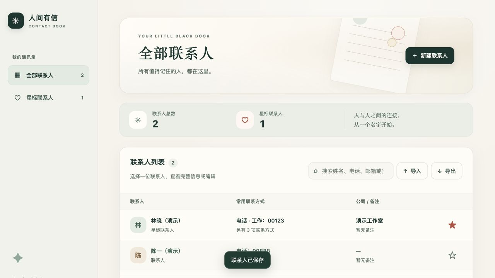
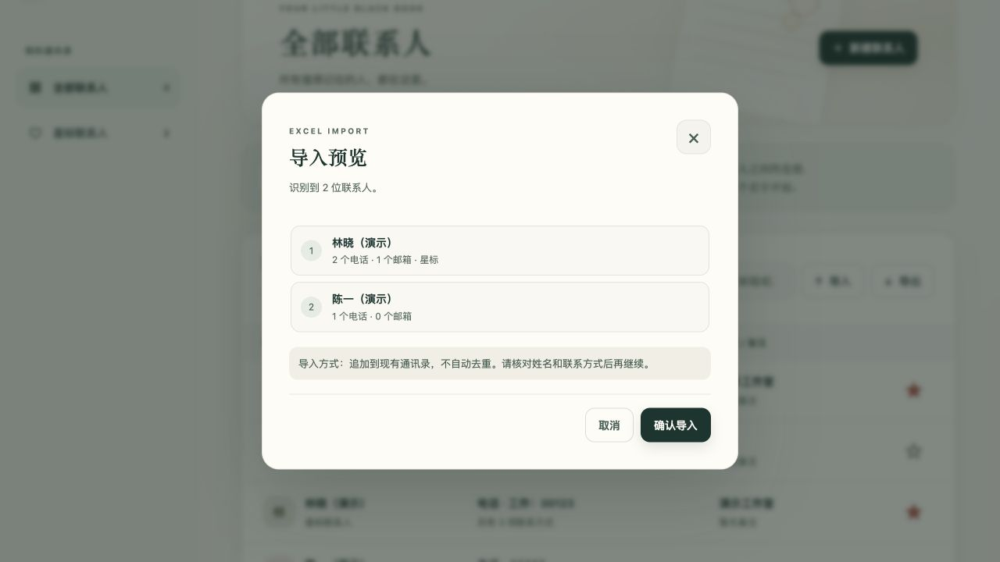
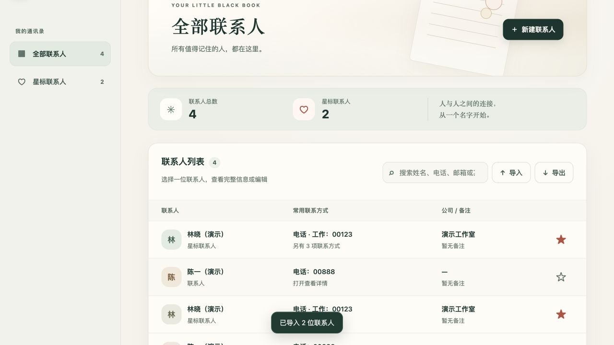

# 极限编程｜人间有信通讯录

| 项目 | 内容 |
| --- | --- |
| 课程 | [EE308FZ Software Engineering（2601_FZU-MU_SE）](https://bbs.csdn.net/forums/2601_MU_SE_FZU) |
| 队名 | 〔填写〕 |
| 作业要求 | [Extreme Programming 作业原帖](https://bbs.csdn.net/topics/620593436) |
| 作业目标 | 完成收藏、多种联系方式和 Excel 导入导出，实践结对开发与 Git 协作。 |
| 参考资料 | [Python 标准库文档](https://docs.python.org/3/library/)、[GitHub 协作者指南](https://docs.github.com/en/repositories/managing-your-repositorys-settings-and-features/repository-access-and-collaboration/inviting-collaborators-to-a-personal-repository) |

## 目录

1. [项目链接](#项目链接)
2. [功能设计与实现](#功能设计与实现)
3. [运行截图和演示视频](#运行截图和演示视频)
4. [Git 提交与成员分工](#git-提交与成员分工)
5. [协作中的问题与解决办法](#协作中的问题与解决办法)
6. [PSP](#psp)

## 项目链接

| 材料 | 地址 |
| --- | --- |
| GitHub 共享仓库 | 〔粘贴实际仓库地址〕 |
| 代码规范 | 〔粘贴仓库中 `CODE_STANDARDS.md` 的地址〕 |
| Pull Request | 〔粘贴实际 PR 地址〕 |
| Release | 〔粘贴实际发布版本地址〕 |
| 在线演示 | [人间有信 · 联系人](https://renjian-youxin-addressbook-2026.loneflora4.chatgpt.site) |

本地版需要 Python 3.10+。在项目目录运行 `python3 app.py`，打开 `http://127.0.0.1:8765`。在线版将数据保存在当前浏览器，用虚构联系人即可体验全部功能。

## 功能设计与实现

- **收藏联系人**。每个联系人记录收藏状态。列表显示星标，也可切换到星标视图，快速定位常用联系人。
- **多种联系方式**。联系方式用一组包含类型、标签和值的条目保存。同一人可以拥有多个电话、邮箱、社交账号或地址。旧数据中的电话、邮箱和地址也可以读取。
- **Excel 导入导出**。`.xlsx` 中每个联系人占一行，基础信息和每条联系方式分别写入有标题的列。电话用文本写入，保留前导零。导入分预览和确认两步，确认后追加，现有记录继续保留。
- **界面与存储**。本地版由 Python 提供接口并保存 JSON。在线版复用主要界面，在浏览器内保存数据和处理 Excel。桌面显示列表，窄屏显示联系人卡片。

## 运行截图和演示视频

[完整运行演示（MP4）](docs/evidence/address-book-demo.mp4)展示从空通讯录开始，新建联系人、查看多种联系方式、按星标筛选、导出再导入 Excel，以及刷新后核对字段。发布到 CSDN 时，请上传上方图片和视频，或替换为助教可访问的绝对链接。

## Git 提交与成员分工

〔粘贴共享仓库 Commits 页面截图，显示实际提交记录。〕

| 成员与 GitHub 用户名 | 实际代码与分工 | Commit 数 | 贡献比例 |
| --- | --- | ---: | ---: |
| 〔本人〕 | 〔填写本人实际改动和测试〕 | 〔填写〕 | 〔填写〕 |
| 〔队友〕 | 〔填写队友实际改动和测试〕 | 〔填写〕 | 〔填写〕 |
| 合计 |  | 〔至少 3〕 | 100% |

## 协作中的问题与解决办法

- 本人遇到的问题、解决办法和复查结果 〔按实际情况填写〕
- 队友遇到的问题、解决办法和复查结果 〔按实际情况填写〕

## PSP

〔附本人和队友各自填写的一张 PSP 表，记录计划与实际耗时。〕

发布前替换所有占位、核对两人的分工与 GitHub 记录，并检查图片和视频访问。两位组员分别发布自己的版本并提交自己的博客链接。
